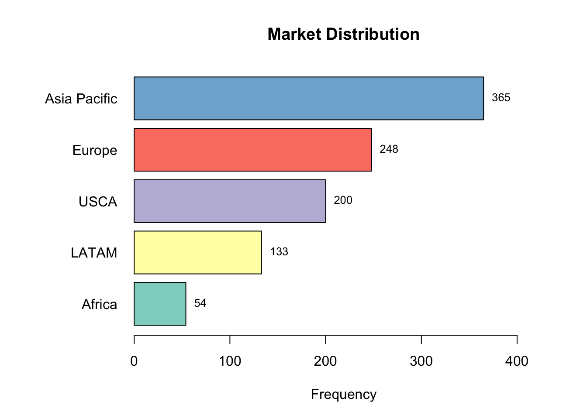
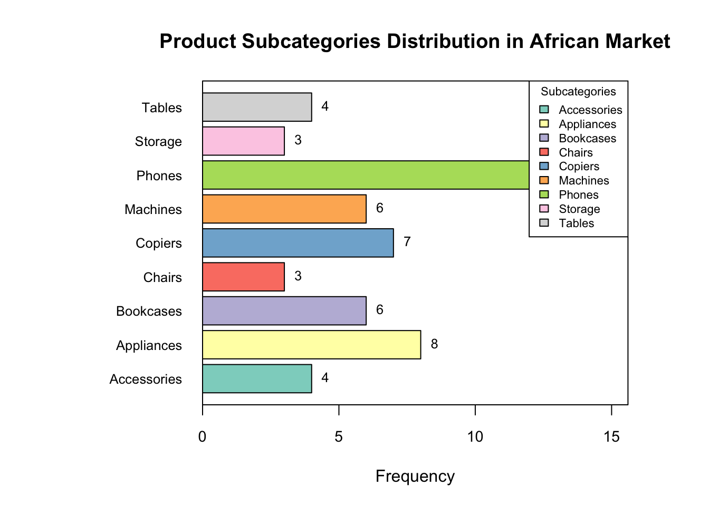
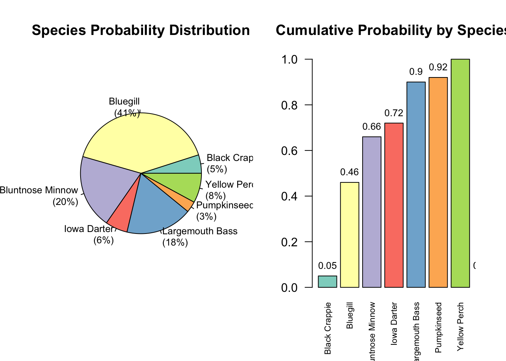
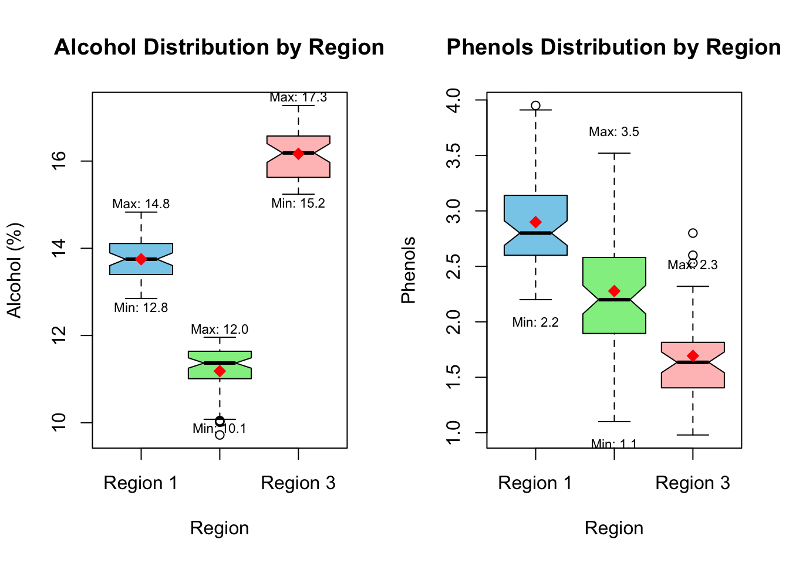
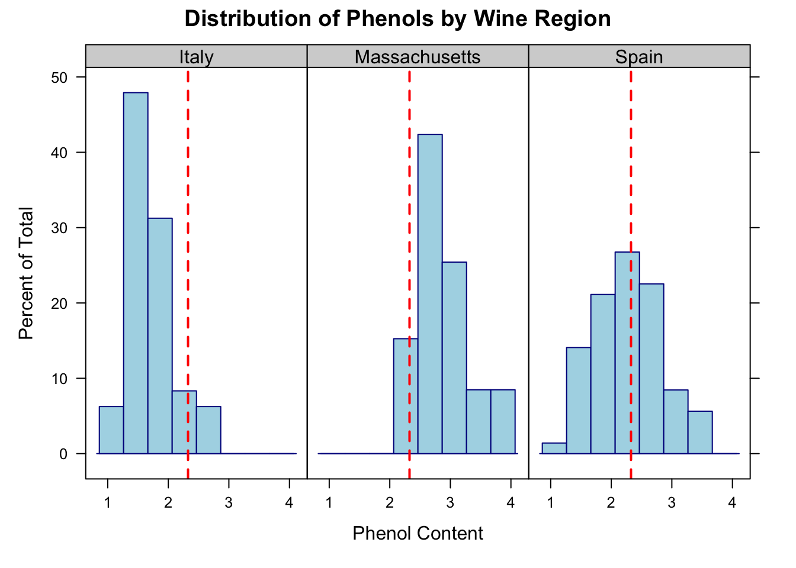
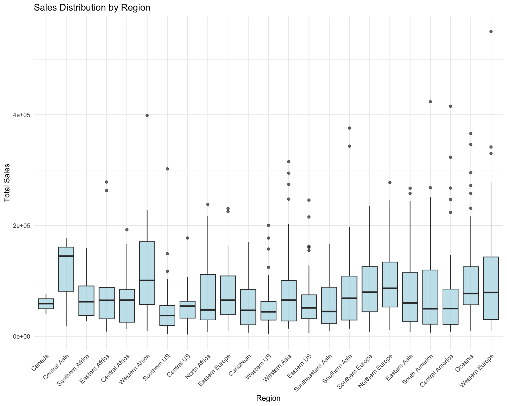
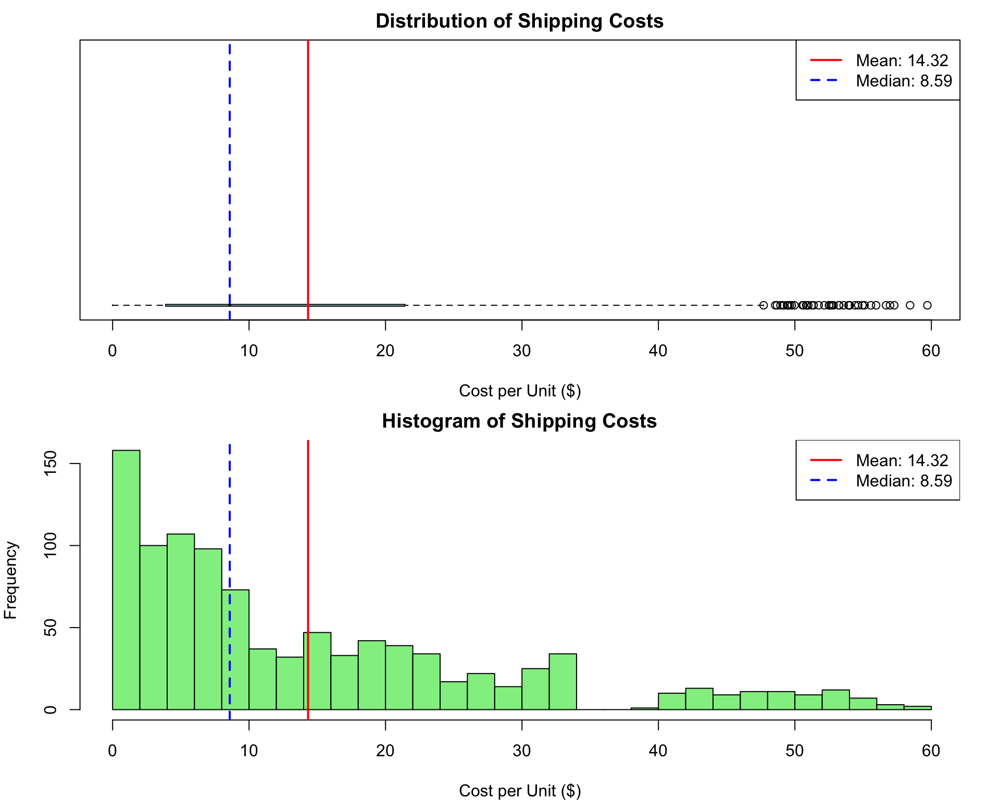
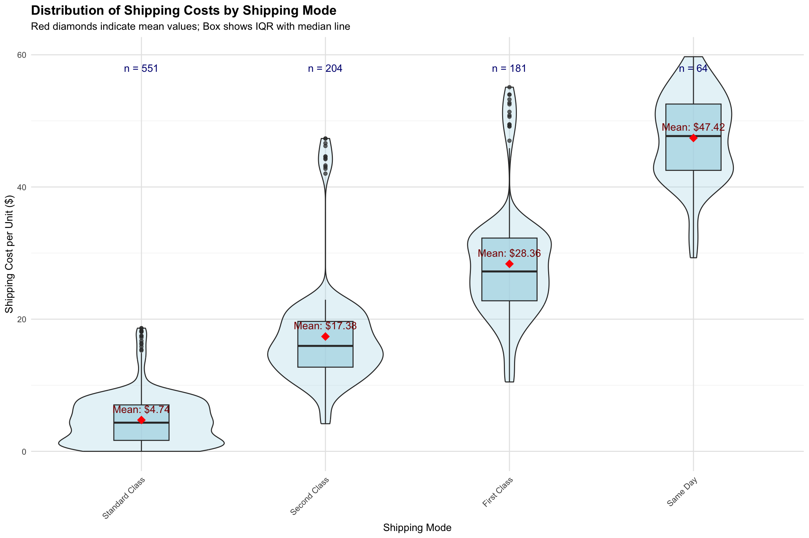

# ALY6000 — Introduction to Analytics: R Analytics Series

**By Dev Panchal, Northeastern University — ALY6000, instructor Dr. Dee / Diana Chiluiza, Jan–Feb 2025.**

This is not one homework file. It is a series that starts with R basics and ends with a full global sales analysis. If you only read this page, you should understand what was done, what was found, and why it matters — no code needed.

**In plain English:** I used R to turn raw tables into answers a business or a researcher can act on: which regions sell, what costs eat profit, which fish species dominate a lake, how wine differs by region, and which markets drive global sales.

**Tools:** R, R Markdown, tidyverse / dplyr, ggplot2, readxl, psych, kableExtra.

**How it flows:** Data → Clean and summarise in R → Charts and tables → Findings and recommendations. Each project folder below contains the original code and the full rendered report.

---

## Learning R: How to Summarise Data

**What it is:** The starting point: R objects, vectors and matrices, and basic statistics — mean, median, standard deviation and quantiles, including car-speed data and a revenue matrix.

**Files:** `project1/Panchal_Project1_Script.R`, `project1/ALY6000_Project1_Report.pdf`

**What to take from it:** The foundations every later project builds on — loading data, summarising it correctly, and reporting it cleanly.

---

## Why Sales and Profits Differ by Region

**Question:** Why do some regions sell well and others struggle — and what should a company do about it?

**Data:** `data/M2Project_Data_2023.xlsx` — sales, profits, shipping costs and product categories across global regions.

**What I did:** Descriptive statistics, comparisons across regions, and boxplots, histograms and bar charts in R.

**Findings:**
- Profit margins vary greatly between regions, and product success changes from market to market.
- Shipping costs affect profit differently in each region — they are not a fixed overhead.
- Africa shows growth potential despite a low current presence; Latin American regions show diverse profit patterns that need tailored approaches, not one global plan.

**Conclusion:** Grow in Africa with products that already sell well there, price differently by region based on profit, tailor marketing to weaker regions, and optimise shipping routes by regional cost. Track regional performance regularly instead of judging the business as one average.

**Files:** `project2/Panchal_ALY6000Project2.Rmd`, `project2/Panchal_ALY6000Project2.html`

---

## Fish in Inch Lake: Is the Ecosystem Healthy?

**Question:** What does the fish population of a freshwater lake look like, and is the ecosystem healthy?

**Data:** `data/inchBio.xlsx` — 505 fish specimens across 7 species, with length, weight and species.

**What I did:** Species composition, frequency analysis, morphometric (length / weight) comparison, pie charts and bar plots.

**Findings — the numbers that matter:**
- Bluegill dominates at **41%** of the population, followed by Bluntnose Minnow (**20%**) and Largemouth Bass (**18%**).
- Largemouth Bass has the greatest mean length: **299.28 mm**.
- Black Crappie has the highest mean weight: **360.35 grams**.
- Multiple size classes across species suggest successful reproduction and recruitment.

**Conclusion:** A stable prey base and a spread of species point to a balanced ecosystem, and the 505-specimen sample gives strong confidence in that read. Continued monitoring matters — fish populations are an early indicator of ecosystem change.

**Files:** `project3/M3_Project_Panchal_Codes.Rmd`, `project3/M3_Project_Panchal_Report.html`

---

## Wine Quality by Region: Massachusetts, Spain and Italy

**Question:** How do wine characteristics differ, and can region explain those differences?

**Data:** `data/wineType02.xlsx` — wine alcohol content and phenolic compounds, originally labelled Region 1, 2 and 3.

**What I did:** Descriptive statistics, regional comparisons, and a data-cleaning fix that matters: recoding Region 1 / 2 / 3 to their real names — Massachusetts, Spain and Italy — so later analysis is actually interpretable. Visualisations include the charts below, built with ggplot2.

**Findings:**
- Alcohol content (typically 11–16%) and phenolic compounds — tannins and anthocyanins that drive colour, astringency and ageing — are the critical quality parameters.
- Regional differentiation matters: the same analysis run with `tapply()` validated the earlier findings, showing the result does not depend on one R function.
- Clean region labels are not cosmetic — without them, regional quality conclusions would be meaningless.

**Conclusion:** Wine quality control needs precise, region-aware measurement. This project also built a reusable framework: understand the data, analyse iteratively, document observations immediately, and tie statistics back to industry context.

**Files:** `project4/M4_Project_Panchal_Code.Rmd`, `project4/M4_Project_Panchal_Report.html`

---

## Global Sales 2023: Where the Money Comes From, and Where It Leaks

**Question:** Across 1,000 orders and multiple markets, where is the money, where is it leaking, and what should change?

**Data:** `data/M6_project_dataset(2023).xlsx` — this dataset was found in the course's Assignment 6 folder, not in the submitted Week 6 folder, and is included here so the code actually runs.

**What I did:** Built Total Sales = Product Price × Quantity and Revenue per Unit, then KPIs, market / segment / shipping analysis, return analysis, and a full ggplot2 chart grid.

**Headline numbers — verified from the report:**
- Total orders: **1,000**
- Total revenue: **$77,998,394.69**
- Average order value: **$77,998.39** | Median order value: **$61,233.04** | Average quantity: **158.52**
- Total returns: **47,592 units** | Net revenue after returns: **about $54.58 million** | Average return rate: **30.05%**

**Revenue by market:**
| Market | Total sales | Share |
|---|---|---|
| Asia Pacific | $24,704,625 | 31.7% |
| Europe | $24,627,127 | 31.6% |
| LATAM | $14,005,415 | 18.0% |
| USCA | $9,533,931 | 12.2% |
| Africa | $5,127,296 | 6.6% |

**Shipping — a clear operational story:**
- North America has the lowest mean shipping cost at **$8.09**, with consistent, predictable costs.
- Africa has the highest mean shipping cost at **$32.82**, with high variability — longer distances and weaker logistics infrastructure, which helps explain lower sales volume there.
- Standard Class shipping offers the most consistent cost structure.

**Conclusion:** Asia Pacific and Europe drive almost two-thirds of revenue, Africa is the smallest market and the most expensive to serve, and returns — nearly a third of quantity on average — are a major profitability leak. The recommendations are market-specific pricing, cutting return rates in high-volume markets, and expanding premium shipping only where customers show they will pay for it.

**Files:** `project6/Panchal_Dev_Project6_Codes.Rmd`, `project6/Panchal_Dev_Project6_Report.html`

---

## How to run it yourself (3 steps)

1. Install R and RStudio, and install the packages listed at the top of each `.Rmd` file (tidyverse, ggplot2, readxl, kableExtra, and the others named there).
2. Open a project `.Rmd` file, make sure the matching dataset from `data/` sits in the same working folder as the code expects, then Knit it in RStudio.
3. The rendered HTML report will rebuild with all tables and charts. The HTML reports already in each project folder show the original output, so you can compare.

## What is NOT in this repo

Certificates from LinkedIn Learning courses in the Week 4 folder, practice / working copies, and professor material — those are not project deliverables, so they were left out on purpose. Nothing here contains personal, confidential or client data; these are course datasets.
